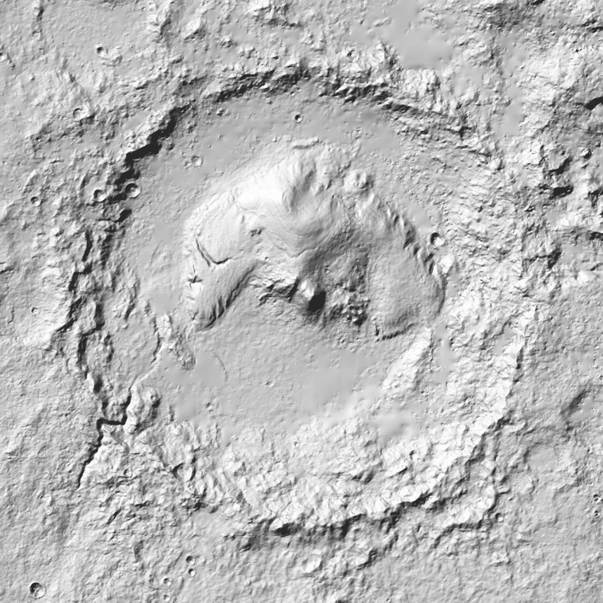

# Mars terrain: data source, data budget, and Unity setup

The game world is Gale Crater, built from real elevation measurements at life size (1:1): one metre in the game is one metre on Mars. This page states exactly what data is used, how much of it, and what is not data.



## Source

| Item | Value |
| --- | --- |
| Product | `Mars_HRSC_MOLA_BlendDEM_Global_200mp_v2` (USGS Astrogeology) |
| Instruments | MGS MOLA laser altimeter blended with Mars Express HRSC stereo terrain models |
| File | <https://planetarymaps.usgs.gov/mosaic/Mars/HRSC_MOLA_Blend/Mars_HRSC_MOLA_BlendDEM_Global_200mp_v2.tif> |
| Format | BigTIFF, 106,694 × 53,347 pixels, signed 16-bit metres, uncompressed, missing value −32768 |
| Projection | Simple cylindrical in degrees on the Mars 2000 sphere, radius 3,396,190 m |
| Grid spacing | 0.003374° per pixel = 200.0 m north–south |
| Vertical reference | Mars areoid (MOLA datum) |
| Retrieved | 14 November 2026 |

**Why not Mars Trek tiles.** [Mars Trek](https://trek.nasa.gov/mars/) displays this same product (layer `Mars_MOLA_blend200ppx_HRSC_Shade_clon0dd_200mpp_lzw`), but its WMTS endpoint serves 8-bit shaded-relief pictures. Pixel brightness in those tiles is lighting, not height. The numbers come from the GeoTIFF that the Trek layer is rendered from.

## Tile used by the game

| Item | Value |
| --- | --- |
| Region | Gale Crater, centred 5.4° S, 137.8° E |
| Bounds | 7.129° S to 3.674° S, 136.072° E to 139.528° E |
| Samples | 1025 × 1025, copied 1:1 from the source (no resampling) |
| Real size | 203.9 km east–west × 204.8 km north–south |
| Elevation range | −4688 m to +1464 m |
| Missing samples | 0 |
| Source pixel origin | column 93675, row 27762 |
| SHA-256 | `1175dd96f0eca689939543a7c150161912e8011282b2681a3df1575fcb88881a` |

## Data budget

| Stage | Amount |
| --- | --- |
| Source file on the server | 11,384,463,908 bytes |
| Downloaded to prepare the tile | 2,113,750 bytes in 1031 range requests (0.0186% of the file) |
| Bundled with the game | 2,101,250 bytes of heights + 2 KB of metadata |
| Network use while playing | none |
| Heightmap in memory | 2,101,250 bytes |
| Terrain meshes in memory | about 2.2 MB: 43 loaded chunks, 28,032 triangles, 84,096 vertices at 26 bytes each |
| Peak terrain meshes while flying 130 km across the crater | about 3.8 MB |
| Rock meshes in memory | about 2.4 MB for roughly 1,560 rocks within 250 m of the viewer |

The mesh figures are for the default settings (40 km render distance) with the viewer 30 m above Curiosity's landing site. Mesh memory is bounded by the render distance, not by the size of the tile. The in-game overlay (F3) shows the live numbers and the same source information.

The download is small because the source stores one image row per strip with no compression. The tool reads the 4 KB header, 8 KB of the row-offset table, the georeferencing tags, and then 2,050 bytes from each of the 1025 rows.

## Scale

One Unity unit is one real metre (1:1), horizontally and vertically, so distances, heights and slopes are all true. The scale is `realMetersPerUnityUnit` on the config. Every other distance on the config (render distance, detail distances, skirt depth, rock sizes) is written in real metres and converted, so changing the scale does not break them.

| Real Mars | In the game |
| --- | --- |
| 204 km tile | 203,891 × 204,800 units |
| Gale Crater, about 154 km across | about 154,000 units |
| 6152 m of relief | 6152 units |
| 200 m source sample | 200 units |
| 1.7 m astronaut eye height | 1.7 units |

The data has one height every 200 m, so at walking height the ground is made of facets 200 m across. Everything smaller than that, including the rocks, is not in the data. Getting finer real detail would need a higher-resolution product for a smaller area (for example HiRISE terrain models near the Curiosity route), which means a larger download.

The world spans ±102 km around the origin. At that distance 32-bit floats resolve about 1 cm, which is fine for terrain but may show as slight jitter on small objects near the tile edges. A floating origin (shifting the world so the player stays near zero) would remove this if it becomes visible.

Real Martian slopes are gentle, so true relief looks flatter than the concept art. `verticalExaggeration` on the config stretches heights if a more dramatic look is wanted; the overlay reports the value, and altitude and slope readouts stay in real units either way.

## What is measured and what is not

- **Measured:** every terrain height. Vertices sit exactly on source samples.
- **Simplified:** the mesh skips samples to get the low-poly look. Within 3 km of the viewer facets use every 200 m sample; farther away they grow to 400 m (to 8 km), 800 m (to 20 km) and 1600 m. Skipping samples can cut off small peaks and pits between the samples kept.
- **Approximated:** east–west spacing uses one value, 199.1 m, for the whole tile. The true spacing varies with latitude by up to 0.33% from north edge to south edge.
- **Invented:** rocks. A 200 m grid cannot resolve boulders, so they are seeded decoration (0.15–1.2 m across, up to 24 per 64 m tile, none on slopes over 15°) and counted separately on the overlay.
- **Colour:** facets are coloured by real slope with three palette colours: terracotta by default, mauve where the slope exceeds 11.5° (about the steepest 10% of the tile: crater walls and Mount Sharp), and dusty rose where it is under 0.8° (about the flattest 7%). Slope is averaged over a 1.6 km window and both triangles of a facet cell share a colour, so colours form regions instead of single-triangle speckle. This is art direction, not a geology map.

## Checks performed

- The tile shows Gale Crater and Mount Sharp in the expected place (preview above).
- Curiosity's landing site (4.5895° S, 137.4417° E): the tile gives −4503 m at the nearest sample and −4501 m interpolated. The published MOLA elevation is about −4501 m. This agrees with the georeferencing and with the areoid vertical reference.
- Mesh builder, run outside Unity on the real tile for all 256 chunks at all four detail levels: triangle and vertex counts, upward-facing winding, normals matching geometry, whole-cell colour bands, outward-facing skirts, and `SampleFacetedY` matching the mesh surface to within 0.0001 units.

Not checked:

- **Streaming and the 1:1 scale have not been run inside Unity yet.** The first version ran in Unity 2022.3.62f3 (built-in render pipeline) and looked as intended. The streaming version was checked against a hand-written stand-in for the Unity API: a simulated 130 km flight across the crater and back loaded and unloaded chunks correctly, kept the pool within its cap, kept the memory accounting consistent, and destroyed every mesh on shutdown. Frame cost inside Unity is not measured; check it with the Profiler.
- The USGS product page could not be fetched (HTTP 403), so the product's own accuracy statement and citation text are not quoted here. Add them before submission.
- Whether HRSC stereo data covers this whole tile was not checked. Where it does not, the 200 m grid is interpolated from coarser MOLA tracks (about 463 m per pixel).

## Regenerating or changing the tile

```
python tools/data/fetch_mars_dem.py
python tools/data/fetch_mars_dem.py --lat -4.59 --lon 137.44 --size 513 --name gale_landing_200m
```

Python 3 standard library only. `--size` minus one should be a multiple of the chunk size (64 by default). The tool prints the bytes transferred and writes them into the metadata file.

## Unity setup

Files, all under `My project/Assets/`:

| Path | Role |
| --- | --- |
| `Data/Terrain/gale_crater_200m.bytes` | Heights: int16 little-endian metres, row 0 = north |
| `Data/Terrain/gale_crater_200m.metadata.json` | Georeferencing, provenance, transfer accounting |
| `Scripts/World/MarsTerrain.cs` | Chunk streaming, detail levels, ground and altitude queries |
| `Scripts/World/MarsChunkMeshJob.cs` | Worker-thread mesh builder |
| `Scripts/World/MarsHeightmap.cs` | Sample, metre, Unity-unit, and latitude/longitude conversions |
| `Scripts/World/MarsTerrainConfig.cs` | Settings asset: scale, chunk size, detail distances, materials, rocks |
| `Scripts/World/MarsRockBuilder.cs` | Seeded rock scatter |
| `Scripts/World/MarsPalette.cs` | The eight palette colours and the matte material recipe |
| `Scripts/World/MarsTerrainDataOverlay.cs` | F3 data panel |
| `Scripts/World/MarsTerrainFlyCamera.cs` | Temporary inspection camera |
| `Scripts/World/Editor/MarsTerrainSetup.cs` | Menu commands |

Steps:

1. Open `My project/` in Unity 2022.3 (or copy `Assets/Data` and `Assets/Scripts` into the existing project).
2. Choose **Mars → Terrain → Create Gale Crater Terrain** (or **Reset Config To Recommended Settings** if the terrain already exists, to pick up new defaults). This creates the config asset and four palette materials, then adds the terrain, a sunset light, fog, and a camera at Curiosity's landing site to the open scene.
3. Press Play. WASD moves, Q/E lowers and raises, right mouse looks, Shift is 15× faster, the scroll wheel changes speed (default 150 m/s; 1.4 m/s is walking pace), F3 toggles the data panel.

For other systems:

```csharp
float y        = terrain.GetGroundY(worldPosition);              // stand on the visible ground
float altitude = terrain.GetGroundElevationMeters(worldPosition); // real metres, areoid reference
float slope    = terrain.GetSlopeDegrees(worldPosition);          // real slope, for route limits
Vector2 latLon = terrain.GetLatLon(worldPosition);
Vector3 site   = terrain.LatLonToWorld(-4.5895, 137.4417);
```

## Running with the weather module

The project uses URP 14 (from the weather module's commit). **Mars → Terrain → Reset Config To Recommended Settings** moves terrain materials made under the built-in pipeline onto URP Lit; without it they render pink.

**Mars → Add Weather To Terrain Scene** adds `Assets/MarsWeather/Prefabs/MarsWeather.prefab` to the open scene, assigns the sun, turns on camera post-processing, and adds `MarsWorldWeatherLink` (`Assets/Scripts/Integration/`). The link:

- hands fog, sky and ambient light to the weather controller, while the terrain keeps setting the camera far clip;
- rescales the weather's fog density from its 60 m preview stage to the map, so clear weather fades the terrain out at about 38 km and a full dust storm, which the weather module makes 5.5 times as dense, at about 7 km;
- keeps the weather particles centred on the camera at ground level;
- adds keys 1–5 to switch weather for testing.

The weather controller sets its own flat ambient light and sky colours, so scenes look greyer than the terrain's purple trilight fill. That is the weather module's art direction; change it there if the team prefers the concept-art palette. Visibility figures are visual choices, not measured Mars values.

## How the generator stays cheap

- The tile is divided into 16 × 16 chunk slots of 64 × 64 cells (12.8 km per side). Chunks are generated when they come within the render distance (40 km by default) and unloaded once they are 3 km beyond it, so chunks on the boundary do not flicker in and out.
- Loads and detail changes go into one queue, nearest first. Only the square of slots around the viewer is checked, not the whole grid.
- Unloaded chunk objects are pooled (up to 48) and reused. Their mesh memory is released as soon as they unload.
- Fog ends just inside the render distance and the sky colour matches the fog, so chunks fade out before they unload instead of popping.
- Each loaded chunk picks one of four detail levels by distance (boundaries at 3, 8 and 20 km), so only nearby ground is dense.
- Rocks stream separately on their own grid of 64 m tiles, built within 250 m of the viewer (at most 8 tiles per frame) and released beyond that.
- The terrain can only extend as far as the prepared tile (204 km). Going further would need more tiles from `fetch_mars_dem.py`, at about 2 MB each.
- Chunk meshes are built on worker threads with Unity's job system, writing directly into mesh buffers. Nothing is allocated on the managed heap per rebuild.
- Detail is re-evaluated only after the viewer moves about one facet, and at most four chunks are rebuilt per frame.
- Ground height comes from the heightmap, so movement needs no mesh colliders. Colliders on the nearest chunks are an option on the config.
- Each chunk draws with at most three solid-colour materials. Short vertical skirts hide the seams between detail levels.
