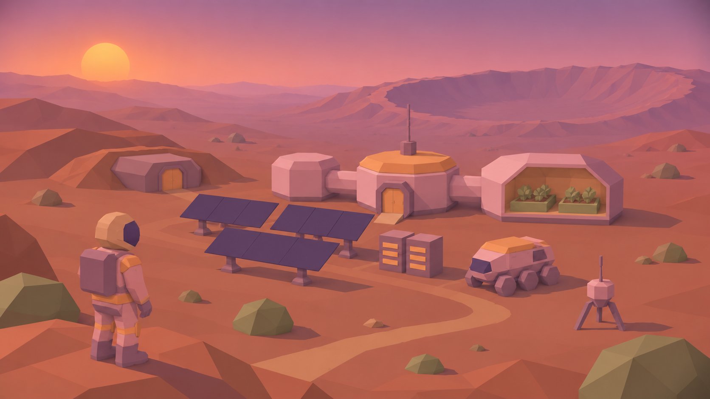
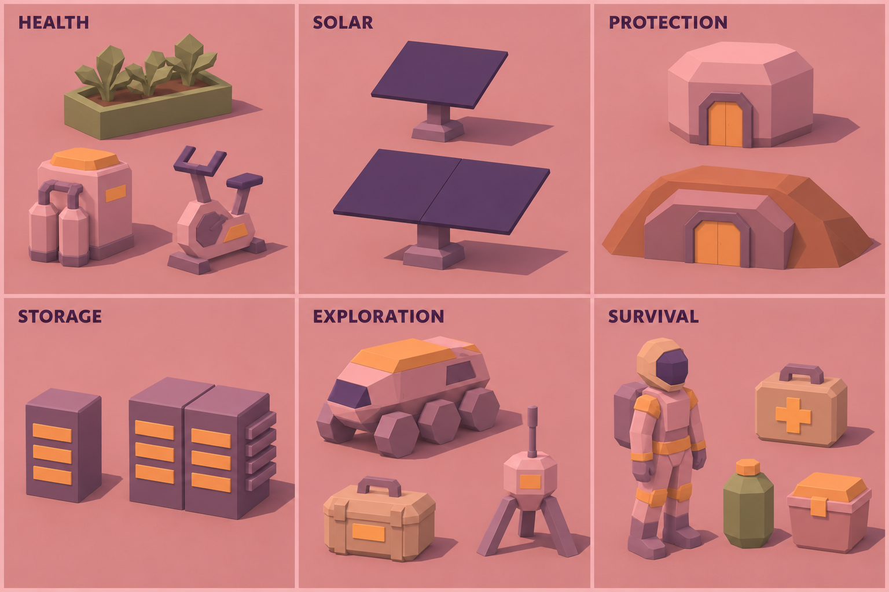
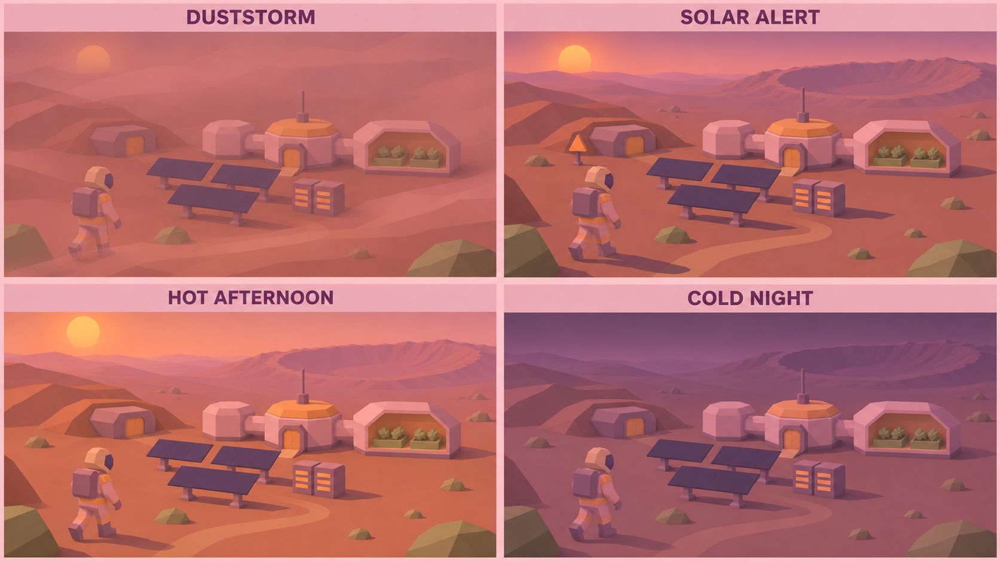

# Game Design References

## Shared theme: a dusty sunset outpost

A small, practical Mars base surrounded by broad crater walls, angular rocks, and open terrain. The world uses stylized low-poly, flat-shaded 3D: terracotta ground, dusty rose structures, muted olive crops, deep purple equipment, and a pale pink sky. Warm orange marks doors, controls, and important equipment.

The three original concept boards below define the shared look. The online packs supply 3D geometry references; their original palettes and materials need the changes listed below.

## 1. World, terrain, and base

**Use this for:** the overall scene, exploration routes, habitat silhouettes, terrain shapes, and lighting.

- Broad triangulated slopes and crater rims make the landscape readable from a distance. Scatter chunky icosphere rocks with a few large faces.
- Build the base from short octagonal modules and simple connecting tunnels. Keep the shelter low and partly covered by a terracotta berm.
- Keep solar panels broad and dark purple so the energy infrastructure is easy to identify.
- Use the astronaut, rover, and survey beacon to establish scale and suggest an exploration route.
- Keep plants inside the greenhouse. Its missing front wall is an architectural cutaway for this reference; the game building remains enclosed.
- For terrain prepared from elevation data, preserve the large landforms and simplify the visible mesh into flat faces. Use solid terrain colors.

## 2. Survival equipment and research upgrades

| System | Reference design | How progression should read |
| --- | --- | --- |
| Health and farming | Raised olive crop beds, a faceted oxygen recycler, and a simple exercise bike. | Add crop trays, larger equipment, and extra canisters. Keep leaves angular and recognizable through growth stages. |
| Solar generation | One plain purple panel on a pedestal. | Add a second panel or a wider array. Show the investment through silhouette and area. |
| Weather protection | A compact octagonal shelter with an orange doorway. | Add a thick outer shell and a low regolith berm. Avoid glowing shields. |
| Energy storage and efficiency | A purple battery cabinet with solid orange charge bars. | Add cabinets for capacity; use a small finned module to distinguish efficiency upgrades. |
| Exploration and research | An angular rover, tripod sensor, and sample case. | Use a consistent family of physical survey equipment at research sites. Keep landmarks visible without neon markers. |
| Human survival | A faceted astronaut, medical case, water canister, and food container. | Distinguish supplies through shape as well as color: a medical plus, canister neck, and lidded food box. |

The four research paths share the same modeling and material rules. Their equipment changes shape as it improves, so upgrades remain readable without introducing more palette colors.

## 3. Weather and event references

| Event | Visual treatment | Gameplay information to preserve |
| --- | --- | --- |
| Duststorm | Terracotta dust volumes, rose fog, lower contrast, and a shorter visible horizon. Use simple geometry or procedural effects without image textures. | Keep the nearby shelter entrance, astronaut, and solar array readable. |
| Solar flare alert | Keep the ordinary sunset scene. Add an orange warning symbol and direct attention to the shelter. | Communicate the event with an alert and exposure readout. The reference does not depict radiation as visible beams. |
| Hot conditions | Shift the lighting toward warm orange and slightly increase distant pink haze. | Keep energy and temperature information clear; avoid heavy distortion. |
| Cold night | Reduce directional-light intensity and shift ambient light toward mauve and deep purple. | Preserve the habitat silhouette and doorway. Avoid saturated blue lighting and bright emissive outlines. |

The hot-afternoon panel supplies the visual direction for the brief's heat events. Use a small corner information window for altitude and the current event; keep it separate from the 3D environment art.

## 4. Online 3D assets and image references

Creator pages and license labels checked on **14 November 2026**. All six linked packs are listed as **CC0** by their creators. Keep the license file from whichever version is downloaded.

These are selected mesh and silhouette sources. The original source previews are linked separately because their colors and rendering vary; the finished game should use the boards and palette in this guide.

| Source | Useful reference | Changes needed for this game | Source preview |
| --- | --- | --- | --- |
| [KayKit: Space Base Bits — Kay Lousberg](https://kaylousberg.itch.io/space-base-bits) | Primary base kit: modular habitats, connecting tunnels, solar panels, cargo, and ground vehicles. The free tier provides 48+ low-poly models in OBJ, FBX, and glTF. | Replace its gradient atlas with solid material assignments or vertex colors. Use rose/clay habitats, purple panels, and orange doors. Check hard normals on selected meshes. | [Pack image](https://img.itch.zone/aW1nLzEzMDYzMjY3LnBuZw%3D%3D/original/r6bSnm.png) |
| [Ultimate Crops Pack — Quaternius](https://quaternius.com/packs/ultimatecrops.html) | Farming reference: 102 crop models, with five growth stages described by the creator; FBX, OBJ, and Blender files. | Restrict foliage to muted olive. Use terracotta or clay containers, simplify small details, and place crops inside the greenhouse. | [Crop models](https://quaternius.com/assets/images/fullres/ultimatecrops.jpg) |
| [Space Station Kit — Kenney](https://kenney.nl/assets/space-station-kit) | Interior reference: 90 3D assets for a coherent space-station environment. Use it when blocking out the habitat's functional spaces. | Apply the shared materials, remove texture dependencies, and simplify any small details that disappear at the game camera distance. | [Kit preview](https://kenney.nl/media/pages/assets/space-station-kit/a795b59757-1712749915/sample.png) |
| [Ultimate Space Kit — Quaternius](https://quaternius.com/packs/ultimatespacekit.html) | Secondary reference for space equipment and animated characters. The creator lists FBX, OBJ, glTF, and Blender formats. | Choose practical human equipment, recolor it, and remove texture-driven detail. Use the generated astronaut as the character target; omit alien vegetation and enemies. | [Kit overview](https://quaternius.com/assets/images/fullres/ultimatespacekit.jpg) |
| [Nature Kit — Kenney](https://kenney.nl/assets/nature-kit) | Rock silhouettes and simple low-poly landscape dressing; 330 3D assets listed. | Select chunky rocks, recolor them terracotta or dusty rose, and use hard normals. Keep Earth foliage out of the open Martian landscape. | [Nature preview](https://kenney.nl/media/pages/assets/nature-kit/656a90532f-1677698896/sample.png) |
| [Space Kit — Kenney](https://kenney.nl/assets/space-kit) | Alternate space-prop and vehicle silhouette reference; 150 3D assets listed. | Select only props needed by the survival loop. Match the primary kit's proportions, replace texture dependencies, and use the same matte palette. | [Space preview](https://kenney.nl/media/pages/assets/space-kit/28e67de6d9-1677698968/sample.png) |

**Concrete starter selection:** KayKit's public repository contains `basemodule_A`, `basemodule_B`, `tunnel_straight_A`, `solarpanel`, `roofmodule_solarpanels`, `spacetruck`, `rock_A`, and `rock_B`. Start with those families and add Quaternius crop stages. The file names can be checked in the creator's [Unity FBX directory](https://github.com/KayKit-Game-Assets/KayKit-Space-Base-Bits-1.0/tree/main/addons/kaykit_space_base_bits/Assets/fbx%28unity%29).

Make the buried shelter, battery variants, oxygen recycler, exercise bike, and survey beacon as simple custom meshes using the systems board. Their shapes are straightforward enough to keep the small asset set consistent.

## 5. Palette and Unity art handoff

The limit is **eight base colors**. Lighting, shading, fog, and sky gradients can produce intermediate pixel colors.

| Color | Hex | Main use |
| --- | --- | --- |
| Terracotta | `#B96D55` | Terrain and shelter berms |
| Dusty rose | `#C78D87` | Habitat and suit panels |
| Muted olive | `#7D8865` | Crops and selected supplies |
| Warm orange | `#E6A06E` | Doors, controls, warnings |
| Deep purple | `#40334F` | Solar panels, batteries, visors, shadow tint |
| Pale pink | `#E9B9BC` | Sky and light structural accents |
| Mauve | `#806886` | Distant terrain, fog, night ambient |
| Clay sand | `#D8AC8F` | Helmets, containers, structural accents |

- **Geometry:** hard normals on every mesh, no smoothing groups, and low triangle counts. Use six- to eight-sided cylinders, simple boxes, and low-subdivision icospheres. Any trees inside a cultivation module use stacked cones.
- **Normals:** author the flat normals in the modeling tool and preserve them on import. Unity supports imported normals; check that the importer does not smooth the intended facets. [Unity model import reference](https://docs.unity.com/en-us/engine/6000.0/manual/assets-and-media/asset-types/models/importing/fbximporter-model)
- **Materials:** solid Base Color, Metallic 0, Smoothness 0, Specular Highlights off, and Environment Reflections off when using URP Lit. Leave image maps unassigned. A vertex-color approach needs a shader that reads vertex colors. [Unity URP Lit shader properties](https://github.com/Unity-Technologies/Graphics/blob/master/Packages/com.unity.render-pipelines.universal/Shaders/Lit.shader)
- **Lighting:** one directional light about 15–25 degrees above the horizon, warm orange-pink, with soft shadows and purple ambient fill.
- **Sky and fog:** a procedural orange-to-pink-to-purple sky gradient and light pink/purple distance fog.
- **Post-processing:** mild bloom, a slight warm grade, and a light vignette. Keep the geometry and solid colors clear.
- **Readability check:** inspect props at gameplay distance and as silhouettes. Check that panels, batteries, medical supplies, and research equipment remain distinct during a duststorm and at night.

## Original image files

The three boards are AI-generated **images of stylized 3D designs**, created with the built-in imagegen tool. They are visual references, not downloadable meshes or verified Unity screenshots. The first board establishes the style; the other two use it as an image reference.

- [World and base](art/references/mars-outpost.png)
- [Survival systems and research upgrades](art/references/mars-systems.png)
- [Weather and events](art/references/mars-weather.png)
- [Exact generation prompts and input references](art/references/generation-prompts.json)

The boards illustrate the intended look. Verify mesh normals, triangle counts, material settings, and texture removal on the actual game assets during implementation.

